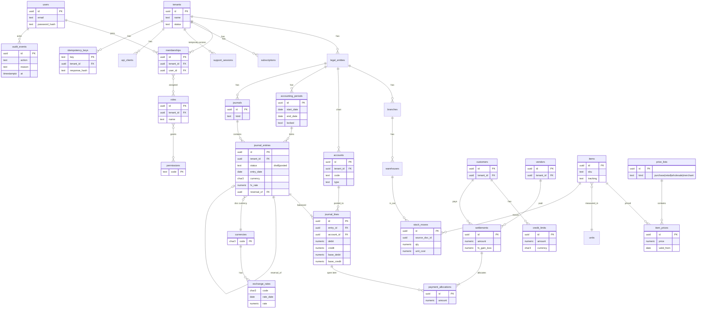

# مخطط ERD - المرحلة 1 (مسودة للمراجعة)

مبني على الصفحة 23 من الملف. كل جدول تشغيلي يحمل `tenant_id`، ويُفرض العزل في الخادم وعلى مستوى قاعدة البيانات (RLS).
المبالغ كلها `NUMERIC(20,4)` وأسعار الصرف `NUMERIC(20,8)`.

## قواعد تُفرض في قاعدة البيانات
- **AC-02:** قيد مرحَّل = مجموع `base_debit` يساوي مجموع `base_credit`، ويُرحَّل داخل معاملة واحدة.
- **عدم التعديل:** منع `UPDATE/DELETE` على القيود المرحَّلة بـ trigger؛ التصحيح بقيد عكسي (`reversal_of`).
- **AC-11:** رفض الترحيل في فترة `locked`.
- **AC-03:** `UNIQUE(tenant_id, key)` على `idempotency_keys`.
- **AC-06:** `item_prices` بتاريخ سريان؛ سطور الفواتير تحفظ السعر الذي استُخدم وقت الإصدار.
- **AC-01:** سياسات RLS على `tenant_id` لكل جدول.
- **المخزون:** حركة مخزون واحدة لكل عملية مرحَّلة، ومنع الرصيد السالب افتراضياً.

## نقاط تحتاج قرارك
1. هل تحتاج عدة كيانات قانونية لكل مستأجر؟ (المسودة تدعمها.)
2. تكلفة المخزون: متوسط مرجَّح أم FIFO؟
3. السياسة الضريبية المحلية وشجرة الحسابات الافتراضية.
4. أسلوب حل تعارضات المزامنة (المرحلة 3).
